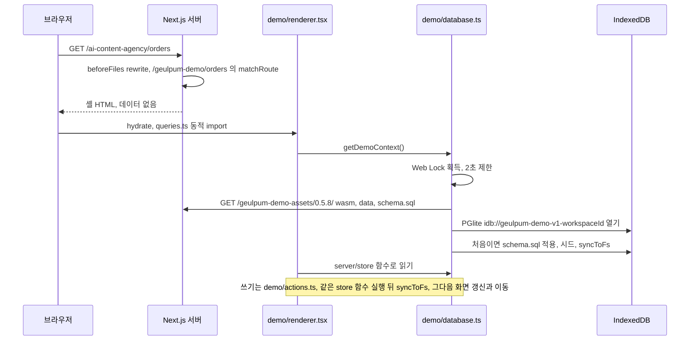

# 아키텍처

한 개의 Next.js 앱이 열 개의 제품(모듈)과 허브를 함께 서비스하고, Vercel 프로젝트 하나로 배포됩니다.
이 문서는 구조와 그 이유를 설명합니다. 코드 규칙 요약은 [`AGENTS.md`](../AGENTS.md)에 있습니다.

## 한눈에 보기

```
브라우저 ──► proxy.ts ──► app/<slug>/… (얇은 라우트)
             │ 방문자 쿠키(워크스페이스) 발급        │
             ▼                                       ▼
        core/workspace ◄──── core/modules ◄──── pocs/<slug>/server/{queries,actions}
                                  │                      │
                                  ▼                      ▼
                             core/db (Drizzle) ──► Postgres  또는  PGlite
                                                   public 스키마: 플랫폼 테이블
                                                   <slug> 스키마: 모듈 테이블
```

| 계층 | 위치 | 책임 |
|---|---|---|
| 라우트 | `src/app/` | URL, 메타데이터, 로딩/에러 경계. 로직 없음 |
| 모듈 | `src/pocs/<slug>/` | 한 제품의 전부: 스키마, 시드, 도메인 로직, 쿼리, 액션, UI, 디자인 문서 |
| 플랫폼 | `src/core/` | 환경변수, DB 연결, 테넌시, 모듈 수명주기, AI, 액션 규약, 포맷 |
| 허브 | `src/hub/` | 모듈 카탈로그(`/`) |

의존 방향은 한쪽입니다: 라우트 → 모듈 → 플랫폼. 플랫폼은 모듈 내부를 import하지 않고(ESLint로 강제),
모듈끼리도 서로 import하지 않습니다. 그래서 모듈 하나를 떼어 내거나 새로 붙여도 나머지는 그대로입니다.

## 데이터베이스

### 드라이버: Postgres 또는 PGlite

`src/core/db/connection.ts`가 같은 Drizzle 타입(`Database`) 뒤에 두 드라이버를 숨깁니다.

| 상황 | `DATABASE_URL` | 드라이버 | 데이터 위치 |
|---|---|---|---|
| 로컬 기본값 | 비어 있음 | PGlite (WASM Postgres) | `.data/pglite` (재시작해도 유지) |
| 로컬 Postgres | `postgres://…localhost…` | postgres.js | Docker의 Postgres 16 |
| 테스트 | — | PGlite | 메모리 |
| Vercel + Neon 등 | pooled URL | postgres.js | 관리형 Postgres |
| Vercel, DB 미연결 | 비어 있음 | PGlite | 인스턴스 메모리 (임시, 경고 로그) |

PGlite는 진짜 Postgres(WASM)라서 SQL·마이그레이션·제약 조건이 운영 DB와 같습니다. 덕분에 `npm run dev`는
설치 없이 바로 돌고, 테스트는 Docker 없이 실제 SQL로 검증됩니다.

### 스키마 분리

- 플랫폼 테이블은 `public` 스키마: `workspaces`, `workspace_modules`(모듈별 시드 여부), `ai_usage`(AI 일일 한도).
- 각 모듈은 자기 Postgres 스키마를 가집니다: `smart-store` → `smart_store`. 테이블 이름 충돌이 없고,
  모듈을 제거할 때는 `DROP SCHEMA smart_store CASCADE` 한 줄이면 됩니다.
- 컬럼은 TS에서 camelCase, DB에서 snake_case (`casing: "snake_case"`).

### 마이그레이션

- 스키마 변경 후 `npm run db:generate` → `/drizzle`에 SQL 마이그레이션 생성 (직접 수정 금지).
  마이그레이션은 플랫폼과 **출시된 모듈**(`src/pocs/slugs.ts`의 `OPEN_MODULE_SLUGS`)만 다룹니다.
  만드는 중인 모듈의 스키마가 섞이지 않고, 모듈마다 자기 마이그레이션을 가진 채 하나씩 `main`에 합쳐집니다.
- `npm run db:migrate`가 적용합니다. Vercel 빌드(`build:vercel`)는 `DATABASE_URL`이 있을 때 자동 실행합니다.
- PGlite는 프로세스 전용이므로 부팅 시 스스로 마이그레이션합니다. 개발 모드에서는 Postgres도 자동 적용됩니다
  (`DB_AUTO_MIGRATE`로 끌 수 있음).
- CI는 스키마와 마이그레이션이 어긋나면 실패합니다.

## 테넌시: 워크스페이스

데모를 공개 배포하면 방문자끼리 데이터가 섞이면 안 됩니다. 그래서 모든 모듈 데이터는 **워크스페이스**에 속합니다.

1. `src/proxy.ts`가 첫 요청에 무작위 UUID 쿠키(`ksp_ws`, httpOnly, 1년)를 발급합니다.
2. `getModuleContext(module)`이 워크스페이스 행을 보장하고(한 시간에 한 번만 `last_seen_at` 갱신),
   그 워크스페이스에서 이 모듈이 처음이면 **시드를 한 번만** 실행합니다(트랜잭션 + 기본키로 동시 요청에도 1회).
3. 모든 쿼리는 `workspaceId`로 필터링하고, 모든 수정/삭제는 `id`와 `workspaceId`를 함께 맞춥니다.
4. 30일(`WORKSPACE_TTL_DAYS`) 동안 쓰지 않은 워크스페이스는 Vercel Cron(`/api/cron/purge-workspaces`)이 지우고,
   `ON DELETE CASCADE`로 모듈 데이터도 함께 정리됩니다.

실제 로그인으로 바꿀 때 바뀌는 곳은 `src/core/workspace/index.ts`의 `getWorkspaceId()` 하나입니다
(세션의 사용자/조직 → 워크스페이스). 모듈 코드는 그대로입니다.

## 글품: 브라우저 안의 Postgres

글품(`ai-content-agency`)만 예외입니다. 방문자 데이터가 서버 DB에 가지 않고, 방문자 브라우저의 PGlite(IndexedDB)에 저장됩니다.
결정 배경은 [ADR 0001](adr/0001-geulpum-browser-pglite.md)과 [ADR 0002](adr/0002-geulpum-single-writer-explicit-sync.md)에 있습니다.



| 단계 | 파일 | 하는 일 |
|---|---|---|
| 라우팅 | `next.config.ts` | `/ai-content-agency/:path*` → `/geulpum-demo/:path*` (`beforeFiles`). `GEULPUM_BROWSER_DEMO=off`면 원래 서버 페이지 |
| 주소 매칭 | `src/app/geulpum-demo/[[...path]]/page.tsx` | URL 조각을 `DemoRoute`로 바꾸고 메타데이터만 정함. 모르는 주소는 404 |
| 렌더링 | `src/pocs/ai-content-agency/demo/renderer.tsx` | 원래 페이지 컴포넌트를 클라이언트에서 그림. `geulpum-demo-change` 이벤트마다 다시 읽음 |
| 액션 교체 | `src/pocs/ai-content-agency/demo/context.tsx` | `DemoProvider`가 서버 액션 대신 같은 이름·타입의 브라우저 액션을 컴포넌트에 줌 |
| 읽기/쓰기 | `demo/queries.ts`, `demo/actions.ts` | 서버와 같은 `server/store/*` 함수를 브라우저 DB에 실행 |
| DB 수명 | `demo/database.ts` | Web Lock, 에셋 로드, PGlite 열기, 마이그레이션 1회, 시드, `syncToFs`, `pagehide`에서 닫기 |
| 에셋 준비 | `scripts/prepare-geulpum-demo.mjs` | `predev`/`prebuild`에서 PGlite 0.5.8 wasm·data와 `0000_platform.sql`+`0003_ai-content-agency.sql`을 `public/geulpum-demo-assets/0.5.8/`에 복사 (git 제외) |

**방문자별 데이터.** 워크스페이스 id는 `localStorage`의 `geulpum-demo-workspace-v1`(무작위 UUID)이고, DB 이름이
`geulpum-demo-v1-<id>`입니다. 다른 방문자의 데이터는 애초에 다른 브라우저에 있습니다. 같은 브라우저 안에서도 저장소 함수는
서버와 똑같이 `workspaceId`로 거릅니다.

**스키마.** 브라우저는 서버와 같은 Drizzle 마이그레이션 SQL을 씁니다. `geulpum_demo_schema` 테이블에 버전 `1`이 없을 때만
한 트랜잭션으로 적용하고 버전을 기록합니다. 그 뒤로는 다시 적용하지 않으므로, 글품 스키마를 바꿀 때는 이 버전 처리도 바꿔야 합니다.

**실패 처리.**

| 상황 | 동작 |
|---|---|
| IndexedDB 또는 Web Locks 없음 | 메모리 DB로 내려가지 않고 "안전하게 저장할 수 없어요" 오류 |
| 다른 탭이 글품을 열고 있음 | 잠금 2초 제한, "다른 탭에서 열려 있어요" 오류 |
| 에셋 응답이 2xx가 아님 | 파일 이름과 상태 코드가 담긴 오류 |
| 초기화 실패 | `getDemoContext()`가 캐시를 비워서 다음 호출이 처음부터 다시 시도 |
| 저장 직후 이동·탭 닫기 | 액션이 `syncToFs()`를 기다린 뒤에만 성공 표시·이동 (`demo/actions.test.ts`) |
| 납품한 원고 수정 시도 | 저장소가 `DELIVERED_LOCK` 오류로 거절 (서버와 같은 규칙) |

**브라우저 데모의 AI.** `demo/queries.ts`의 `getAiMode()`는 항상 `"template"`입니다. 브라우저 데모는 Claude를 부르지 않고
`domain/templates.ts`의 한국어 템플릿으로 시안을 씁니다.

## 모듈의 구조

```
src/pocs/<slug>/
  meta.ts             카탈로그 카드 (이름, 한 줄 소개, 대표 색)
  module.ts           defineModule({ id, schema, seed })
  db/schema.ts        pgSchema("<slug_underscored>") + 테이블 (모두 workspaceId FK, cascade)
  db/seed.ts          새 워크스페이스용 샘플 데이터 (서울 시간 '오늘' 기준)
  domain/             순수 비즈니스 로직 (수수료, 마진, 세금, 충돌 검사…) + 단위 테스트
  server/queries.ts   "server-only" 읽기 — (db, workspaceId) 함수 + getModuleContext 래퍼
  server/actions.ts   "use server" 쓰기 — zod 검증, ActionState 반환, revalidatePath
  components/         UI + CSS Modules (모듈 루트 클래스에 디자인 토큰)
  PRODUCT.md          제품 맥락 (impeccable)
  DESIGN.md           디자인 시스템 (impeccable) + .impeccable/design.json
src/app/<slug>/       layout.tsx(셸+메타데이터), page.tsx…, loading.tsx, error.tsx
```

### 쓰기 경로 (서버 액션)

```ts
// server/actions.ts
"use server";
export const createOrder = formAction(orderInput, async (input) => {
  const { db, workspaceId } = await getModuleContext(smartStore);
  await insertOrder(db, workspaceId, input);        // 테스트 가능한 데이터 함수
  revalidatePath("/smart-store", "layout");
  return { message: "주문을 추가했어요." };
});
```

- 입력은 zod로 검증되고, 실패하면 필드별 오류가 담긴 `ActionState`가 돌아옵니다(예외 아님).
- 예상 가능한 실패는 `UserError("…")`로 사용자에게 보여 주고, 그 밖의 오류는 로그로 남기고 일반 문구를 보여 줍니다.
- 클라이언트는 `useActionState` / `useOptimistic`으로 대기·성공·오류 상태를 그립니다.

### AI

`generateObject` / `generateText`(`src/core/ai`)는 **항상 답합니다.**
`ANTHROPIC_API_KEY`가 있으면 Claude(기본 `claude-opus-5`, 낮은 effort, 서버 측 거절 폴백)를 호출하고,
키가 없거나 일일 한도(`AI_DAILY_LIMIT`)를 넘었거나 API가 실패하면 모듈이 넘긴 한국어 템플릿이 답합니다.
결과에는 `source: "claude" | "template"`가 붙어 UI에 정직하게 표시됩니다.

### 스타일 격리

- 모듈 스타일은 CSS Modules만 씁니다. 토큰은 모듈 루트 클래스의 커스텀 프로퍼티입니다.
- 페이지 배경처럼 `html`에 걸어야 하는 것은 `:global(html):has(.root)`로 — 그 모듈이 화면에 있을 때만 적용됩니다.
- 허브 ↔ 모듈, 모듈 ↔ 모듈 이동은 일반 `<a>`(전체 로드)라서 한 제품의 CSS가 다른 제품에 남지 않습니다.
- 공통으로 깔리는 것은 색 없는 리셋(`app/globals.css`)과 Pretendard 폰트뿐입니다.

## 새 모듈 추가하기

1. `src/pocs/slugs.ts`의 `MODULE_SLUGS`에 slug 추가 (예: `"pet-care"`).
2. `src/pocs/pet-care/`를 위 구조대로 만들고, `meta.ts`를 `src/pocs/registry.ts`에 등록.
3. `db/schema.ts`에 `pgSchema("pet_care")`로 테이블 정의 → `npm run db:generate`.
4. `src/app/pet-care/`에 얇은 라우트 작성. 개발 중에는 `DRIZZLE_MODULE=pet-care npm run db:push`로 개발 DB에 스키마를 맞춥니다.
5. 출시할 때 `OPEN_MODULE_SLUGS`에 slug를 추가하고 `npm run db:generate`로 그 모듈의 마이그레이션을 만듭니다.
   마이그레이션·허브 링크·사이트맵·레거시 리다이렉트·E2E 스모크 테스트가 모두 이 목록을 따릅니다.
6. `npm run check` 통과 확인. 열리기 전의 모듈은 허브에 ‘리뉴얼 공사 중’ 가게로 표시됩니다.

## 운영

| 항목 | 위치 |
|---|---|
| 헬스 체크 | `GET /api/health` — DB 드라이버·연결·AI 상태 |
| 워크스페이스 정리 | Vercel Cron → `GET /api/cron/purge-workspaces` (`CRON_SECRET` 필요) |
| 보안 헤더 | `next.config.ts` (nosniff, frame, referrer, permissions, HSTS) |
| 로그 | 운영에서는 JSON 한 줄 (`src/core/logger.ts`) |
| 예전 URL | `/pocs/NN-<slug>/…` → `/<slug>` 영구 리다이렉트 |
